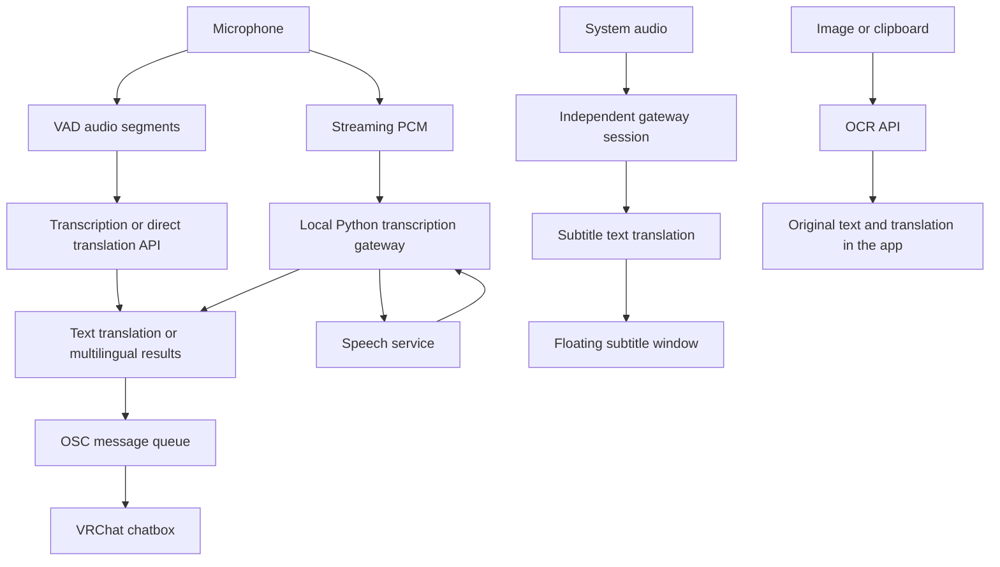

# Architecture and API contracts

[English](architecture.md) / [简体中文](architecture_CN.md)

[User guide](../README.md) · [Development](development.md)

The desktop runtime is Electron. The frontend uses React, TypeScript, Vite, Redux Toolkit, React Router, i18next, HeroUI, and Tailwind CSS. The Python gateway uses FastAPI, WebSocket, and Zeroconf.

Paths below are relative to the repository root.

## Architecture and source layout

| Path | Responsibility |
| --- | --- |
| `src/main.tsx`, `src/App.tsx` | Frontend entry, persisted state restoration, Redux, and routing |
| `src/routes/` | Hash routes for the main window and subtitle window |
| `src/components/` | Shared UI, sidebar, title bar, and recognition status |
| `src/panel/` | Microphone, system audio, subtitles, OCR, settings, and log panels |
| `src/api/commonRouter.ts` | Non-streaming transcription, text translation, direct audio translation, and OCR orchestration |
| `src/api/provider.ts` | Model resolution, capability validation, endpoint construction, and model discovery |
| `src/api/stream.ts`, `src/api/subtitle-stream.ts` | Streaming connections, translation queues, and subtitle sessions |
| `src/store/` | Model contracts, settings, subtitle styles, and localStorage persistence |
| `src/utils/`, `src/constants/` | Audio processing, OSC queue, languages, and model behavior presets |
| `src/i18n/` | Internationalization setup and Chinese, English, Japanese, and Korean translations |
| `src/electron/ipc.ts` | Renderer-side native commands and types |
| `src-electron/main/` | Application lifecycle, IPC, OSC, gateway discovery, system audio, and subtitle windows |
| `src-electron/preload/`, `src-electron/shared/` | Native bridge and shared types |
| `backend/` | FastAPI / WebSocket gateway, transcription protocol, and speech provider adapters |
| `scripts/` | Electron development and release orchestration |

Switching main-window pages keeps them mounted to preserve capture sessions and local state. `/subtitle` is the subtitle window route; `/mix-sound-translate` is currently a placeholder.

The local gateway provides `GET /health` and WebSocket `/transcription`. Clients send `transcription.configure`, wait for `ready`, then upload **16 kHz, mono, signed 16-bit little-endian PCM**. The gateway returns `transcript`, `error`, and other messages, with `transcription.finish` / `done` for finalization.

## Provider and model contracts

### Model types and endpoints

| Model type | Purpose | Request |
| --- | --- | --- |
| `audio-transcription` | Standard speech transcription | `POST {baseURL}/audio/transcriptions` with a WAV file; the response must contain a string `text` field |
| `chat-completion` | Text translation, multimodal transcription, direct audio translation, and OCR | `POST {baseURL}/chat/completions` |
| `minimax-audio-speech-to-text` | Minimax speech transcription | `POST {baseURL}/speech_to_text`; the response must contain a string `text` field |
| `narilab-audio-speech-to-text` | Narilab streaming transcription | Connects to `/realtime?intent=transcription` through the Python gateway |
| `qwen-audio-speech-to-text-realtime` | Qwen ASR realtime transcription | Connects to the Qwen realtime WebSocket through the Python gateway |
| `qwen-audio-speech-to-text-inference` | Qwen Audio / Fun-ASR streaming transcription | Connects to the inference WebSocket through the Python gateway |

For ordinary HTTP APIs, set the Base URL to the API prefix. The app appends the endpoint path shown above. For example, `https://api.example.com/v1` produces chat requests to `https://api.example.com/v1/chat/completions`; do not append `/chat/completions` yourself.

Streaming APIs require the corresponding WebSocket API prefix. A chat API's `/v1` address is not interchangeable with a streaming API address:

- **Narilab:** use an HTTPS Base URL. The gateway converts it to WSS and appends `/realtime?intent=transcription`.
- **Qwen realtime:** accepts HTTP(S) or WS(S) URLs. A host without a path uses `/api-ws/v1/realtime`. A custom path prefix gets `/realtime` appended; an existing `/realtime` suffix is retained. The gateway adds the selected model as the `model` query parameter.
- **Qwen inference:** accepts HTTP(S) or WS(S) URLs. A host without a path uses `/api-ws/v1/inference`. A custom path prefix gets `/inference` appended; an existing `/inference` suffix is retained. A trailing `/realtime` is replaced with `/inference`.

The Qwen adapters convert HTTP(S) URLs to WSS. Create separate provider entries when different API prefixes are needed. Current configuration validation requires a nonempty Base URL, API key, and model ID.

The source also implements an `audio-cpp-live` adapter, but its model type is not currently available in the provider editor.

### Model assignment requirements

| Setting | Configuration slot | Required model |
| --- | --- | --- |
| Voice transcription model | `transcription` | A streaming transcription model, standard audio transcription, Minimax transcription, or a chat model with `audio` |
| Voice translation model | `translation` | A chat model with `text` |
| Voice direct translation model | `direct` | A chat model with `audio + text + tools` |
| OCR model | `ocr` | A chat model with `image + text + tools` |
| System audio transcription model | `subtitleTranscription` | A streaming transcription model |
| System audio translation model | `subtitleTranslation` | A chat model with `text` |

Model selectors filter by model type and declared capabilities. Enabling a capability controls selection and request behavior; the service must actually support it.

## Configuration storage and data flow

Providers, API keys, model selections, output templates, prompts, language, sidebar order, and subtitle styles are saved in the current app's localStorage under the root key `redux-persist`. The current implementation stores API keys directly with the local configuration.

Ordinary API requests go from the renderer to the selected provider. Streaming recognition passes provider configuration and credentials to the local Python gateway, which connects to the speech service. Depending on the feature in use, audio, text, or images are sent to the corresponding service.
