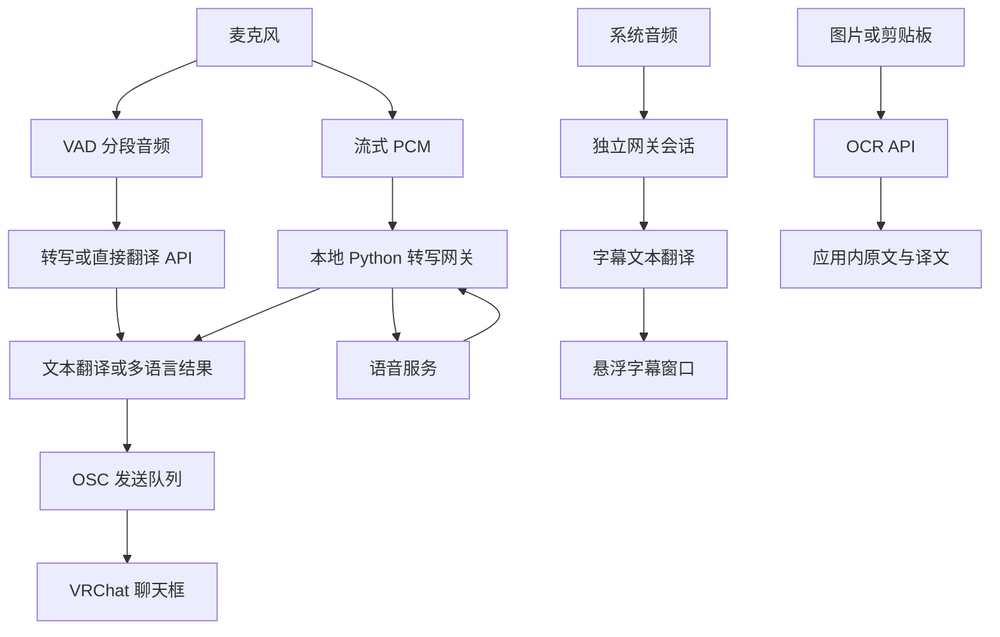

# 架构与接口约定

[English](architecture.md) / [简体中文](architecture_CN.md)

[用户指南](../README_CN.md) · [开发指南](development_CN.md)

桌面运行时为 Electron；前端使用 React、TypeScript、Vite、Redux Toolkit、React Router、i18next、HeroUI 和 Tailwind CSS；Python 网关使用 FastAPI、WebSocket 和 Zeroconf。

下文源码路径均相对于仓库根目录。

## 架构与目录

| 路径 | 职责 |
| --- | --- |
| `src/main.tsx`、`src/App.tsx` | 前端入口、持久化恢复、Redux 和路由挂载 |
| `src/routes/` | 主窗口页面与字幕窗口的 Hash 路由 |
| `src/components/` | 公共 UI、侧栏、标题栏和识别状态 |
| `src/panel/` | 麦克风、系统音频、字幕、OCR、设置和日志面板 |
| `src/api/commonRouter.ts` | 分段转写、文本翻译、直接音频翻译和 OCR 请求编排 |
| `src/api/provider.ts` | 模型解析、能力校验、端点拼接和模型发现 |
| `src/api/stream.ts`、`src/api/subtitle-stream.ts` | 流式连接、翻译队列和字幕会话 |
| `src/store/` | 模型契约、设置、字幕样式和 localStorage 持久化 |
| `src/utils/`、`src/constants/` | 音频处理、OSC 队列、语言与模型行为预设 |
| `src/i18n/` | 国际化初始化及中、英、日、韩翻译资源 |
| `src/electron/ipc.ts` | 渲染端原生命令及类型 |
| `src-electron/main/` | 应用生命周期、IPC、OSC、网关发现、系统音频和字幕窗口 |
| `src-electron/preload/`、`src-electron/shared/` | 原生桥接及共享类型 |
| `backend/` | FastAPI / WebSocket 网关、转写协议和语音供应商适配器 |
| `scripts/` | Electron 开发与发布编排 |

主窗口切换页面时保持各页面挂载，以保留采集会话与局部状态。`/subtitle` 是字幕窗口路由；`/mix-sound-translate` 目前为占位页面。

本地网关提供 `GET /health` 和 WebSocket `/transcription`。客户端先发送 `transcription.configure`，收到 `ready` 后上传 **16 kHz、单声道、16 位小端 PCM**。网关返回 `transcript`、`error` 等消息，并支持 `transcription.finish` / `done` 收尾协议。

## 供应商与模型契约

### 模型类型与接口

| 模型类型 | 界面用途 | 请求方式 |
| --- | --- | --- |
| `audio-transcription` | 标准语音转写 | `POST {baseURL}/audio/transcriptions`，上传 WAV，响应需包含字符串 `text` |
| `chat-completion` | 文本翻译、多模态转写、直接音频翻译、OCR | `POST {baseURL}/chat/completions` |
| `minimax-audio-speech-to-text` | Minimax 语音转写 | `POST {baseURL}/speech_to_text`，响应需包含字符串 `text` |
| `narilab-audio-speech-to-text` | Narilab 流式转写 | 通过 Python 网关连接 `/realtime?intent=transcription` |
| `qwen-audio-speech-to-text-realtime` | Qwen ASR 实时转写 | 通过 Python 网关连接 Qwen realtime WebSocket |
| `qwen-audio-speech-to-text-inference` | Qwen Audio / Fun-ASR 流式转写 | 通过 Python 网关连接 inference WebSocket |

普通 HTTP 接口的 Base URL 应填写到接口前缀，应用会追加表中的路径。例如填写 `https://api.example.com/v1` 后，聊天请求会发送到 `https://api.example.com/v1/chat/completions`，无需再填写 `/chat/completions`。

流式接口应使用对应服务的 WebSocket API 前缀，不能一律套用聊天接口的 `/v1` 地址：

- **Narilab**：Base URL 使用 HTTPS，网关将其转换为 WSS，并追加 `/realtime?intent=transcription`。
- **Qwen realtime**：支持 HTTP(S) 或 WS(S) 地址。仅填写主机时使用 `/api-ws/v1/realtime`；填写路径前缀时追加 `/realtime`，已有 `/realtime` 则保留。网关会附加所选模型的 `model` 查询参数。
- **Qwen inference**：支持 HTTP(S) 或 WS(S) 地址。仅填写主机时使用 `/api-ws/v1/inference`；填写路径前缀时追加 `/inference`，已有 `/inference` 则保留。若以 `/realtime` 结尾，会替换为 `/inference`。

Qwen 适配器会将 HTTP(S) 地址转换为 WSS。不同接口前缀可以分别建立供应商配置。当前配置校验要求 Base URL、API Key 和模型 ID 均非空。

源码还实现了 `audio-cpp-live` 适配器，但当前供应商编辑器未开放该类型的选项。

### 模型分配要求

| 界面配置 | 配置槽位 | 所需模型 |
| --- | --- | --- |
| 语音转写模型 | `transcription` | 流式转写模型、标准语音转写、Minimax 转写，或支持 `audio` 的聊天模型 |
| 语音翻译模型 | `translation` | 支持 `text` 的聊天模型 |
| 语音直接翻译模型 | `direct` | 同时支持 `audio + text + tools` 的聊天模型 |
| OCR 模型 | `ocr` | 同时支持 `image + text + tools` 的聊天模型 |
| 系统音频转写模型 | `subtitleTranscription` | 流式转写模型 |
| 系统音频翻译模型 | `subtitleTranslation` | 支持 `text` 的聊天模型 |

下拉框会按类型和已声明的能力过滤模型。勾选能力只影响应用的选择和请求方式，不会让服务端模型获得对应能力。

## 配置保存与数据流向

供应商、API Key、模型选择、输出模板、提示词、语言、侧栏顺序和字幕样式保存在当前应用的 localStorage 中，根键为 `redux-persist`。当前实现将 API Key 随配置直接保存到本地。

普通请求由渲染端发送到所选供应商；流式识别会将供应商配置和凭据交给本地 Python 网关，再由网关连接语音服务。音频、文本和图片会按所使用的功能发送到对应服务。
